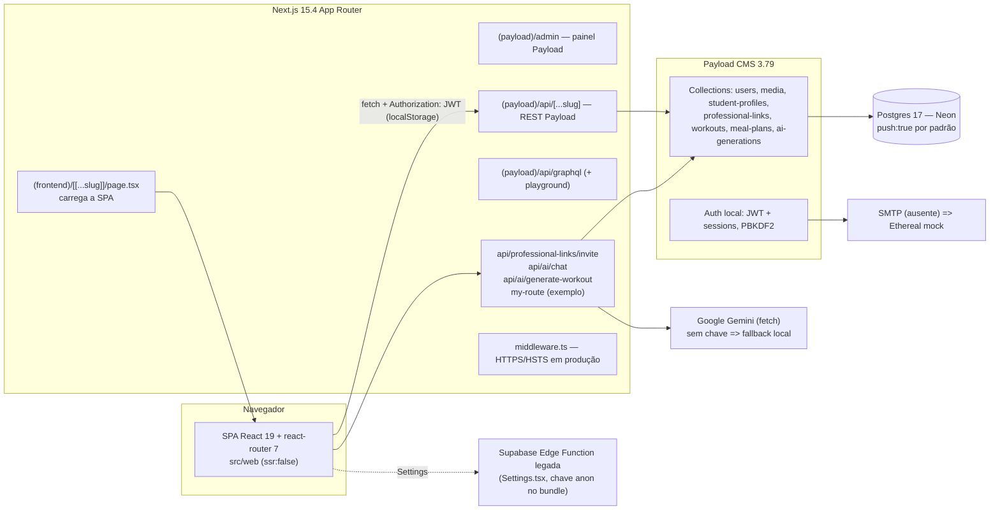
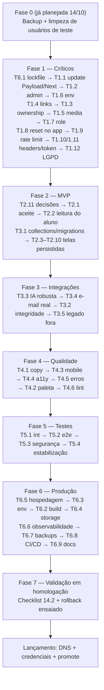

# CoachPass — Auditoria Técnica e Plano de Produção

> Fonte única de acompanhamento do projeto. Gerado em 20/10/2026 a partir de leitura integral do código, consultas somente-leitura ao banco e execução de verificações não destrutivas (TypeScript, ESLint, `next build`, `npm audit`, Vitest). Nenhum dado, usuário ou configuração foi alterado.
>
> Legenda de confiança usada em todo o documento:
> - **Comprovado** — evidência direta em código, saída de comando ou banco.
> - **Risco potencial** — padrão que normalmente causa problema, mas não foi reproduzido.
> - **Precisa investigar** — requer teste em ambiente rodando ou acesso externo.
>
> Prioridades: **P0** crítico (bloqueia lançamento) · **P1** alto (compromete MVP) · **P2** médio · **P3** baixo.

---

## 1. Resumo executivo

**Veredito: o CoachPass NÃO está pronto para produção.** O núcleo técnico (Next.js 15 + Payload CMS 3 + Postgres/Neon) está de pé e compila, mas o produto é um MVP com o fluxo central incompleto e falhas de autorização comprovadas.

O que funciona de ponta a ponta (com evidência):
- Cadastro, login, logout, troca de senha e envio de "esqueci a senha" via Payload, com política de senha validada no servidor.
- Onboarding e perfil do aluno persistidos em `student-profiles`.
- Convite de aluno por e-mail (cria vínculo `pending`).
- Geração de treino por IA para o aluno (com quota 2/mês e bloqueio por risco), persistida em `workouts`; leitura de treinos e dietas publicados.
- Dashboards de personal e nutricionista listando vínculos.
- Build de produção e TypeScript sem erros.

O que impede o lançamento:
1. **Autorização frouxa no servidor** — qualquer usuário autenticado entra no painel `/admin`; aluno cria treino/dieta em nome de terceiros; profissional cria vínculo `active` direto pela REST, pulando o convite; qualquer usuário altera ou apaga qualquer arquivo em `media`.
2. **Fluxo de vínculo não fecha** — o aluno não tem como aceitar o convite e só o master pode mudar o status; o profissional também não consegue ler o perfil do aluno vinculado.
3. **Quase toda a operação profissional é mock** — criar treino, criar plano alimentar, agenda, avaliação, consulta, anamnese, restrições, relatório e perfis profissionais não gravam nada no banco.
4. **Recuperação de senha quebrada em produção** — sem SMTP o Payload usa a conta de teste Ethereal; o e-mail nunca chega ao usuário, e o link leva ao painel admin do Payload, não ao app.
5. **Dependências com vulnerabilidades críticas** — `payload@3.79.0` e `next@15.4.11` têm advisories críticos publicados (inclui account takeover pré-autenticação na recuperação de senha do Payload). `npm audit`: 49 vulnerabilidades, 5 críticas, 29 altas.
6. **Infra inconsistente** — `pnpm` declarado mas lockfile é npm; `Dockerfile` exige `output: 'standalone'` que não existe; `docker-compose` sobe Mongo; schema em modo `push` por padrão; migration não cobre `ai-generations`; sem CI, monitoramento ou backup documentado.

Contagem de problemas registrados: **P0: 9 · P1: 17 · P2: 24 · P3: 7** (total 57; detalhamento na seção 12).

---

## 2. Arquitetura encontrada

Verificada no código (não presumida):

| Camada | Realidade encontrada | Observações |
|---|---|---|
| Monorepo | Raiz com `apps/fitsync-cms` (único app), `docs/`, `.cursor/` | `apps/fitsync-cms.zip` untracked na raiz |
| Frontend | SPA React Router montada por `apps/fitsync-cms/src/app/(frontend)/[[...slug]]/page.tsx` com `dynamic(..., { ssr: false })` | SEO/SSR inexistentes para o app; landing também é CSR |
| Backend | Payload CMS 3.79.0 dentro do mesmo Next; REST + GraphQL gerados | 3 rotas custom + 1 rota de exemplo do template |
| Banco | Postgres 17.11 (Neon) via `@payloadcms/db-postgres`, 18 tabelas, 9,6 MB | `payload_migrations` tem entrada `dev` (batch -1) e 1 migration |
| Auth | JWT Payload em `localStorage` (`fitsync_payload_token`, `fitsync_user`) + cookie `secure` só em produção | Token também salvo dentro de `fitsync_user` |
| IA | Gemini via `fetch` direto (`src/services/ai/geminiProvider.ts`), modelo `GEMINI_MODEL \|\| 'gemini-3.6-flash'` | `GEMINI_API_KEY` ausente no `.env` atual → fallback local |
| E-mail | `@payloadcms/email-nodemailer`; sem `SMTP_*` cai em Ethereal | Build de produção imprime contas Ethereal no log |
| Estilo | Tailwind 4 (CSS-first), `motion`, `lucide-react`, `sonner` | 46 componentes shadcn em `src/web/components/ui` não usados |
| Legado | `src/lib/supabase/info.tsx`, `supabase/functions/server/*`, MUI/Radix/react-dnd no `package.json` | Resquícios do protótipo Figma Make |
| Infra | `Dockerfile` (standalone), `docker-compose.yml` (mongo+postgres), sem CI, sem `vercel.json` | Nenhum pipeline |

Ferramentas: Node 24.14 local; `engines` pede Node ≥18.20/20.9 e **pnpm**; `packageManager: pnpm@12.4.2`; lockfile versionado é `package-lock.json` (npm).

---

## 3. Inventário de funcionalidades

Classificação: **Operacional** (fluxo completo verificado) · **Parcial** · **Mock/UI apenas** · **Ausente**.

### 3.1 Compartilhado / público

| Funcionalidade | Status | Evidência |
|---|---|---|
| Landing pública com header/âncoras | Operacional | `src/web/components/pages/Home.tsx` |
| Cadastro (aluno/profissional) | Operacional | `Register.tsx` → `POST /api/users` + login automático |
| Login único com roteamento por role | Operacional | `Login.tsx`, `AuthContext.tsx` |
| Logout | Operacional | `AuthContext.logout` → `/api/users/logout` |
| Esqueci a senha (envio) | Parcial | Envia via `/api/users/forgot-password`; **sem SMTP não entrega**; link aponta para `/admin/reset/:token` |
| Redefinir senha no app | Ausente | Não há rota `/reset-password` em `src/web/routes.tsx` |
| Alterar senha (Configurações) | Operacional | `AuthContext.changePassword` (login + PATCH) |
| Política de senha (front + back) | Operacional | `src/lib/passwordPolicy.ts`, hook `beforeOperation` em `Users.ts` |
| Tema claro/escuro | Operacional | `ThemeContext.tsx` (`coachpass-theme`) |
| Página `/planos` | Mock/UI | `Plans.tsx` botões "Em breve" |
| `/privacidade`, `/termos` | Parcial | Rotas existem; Login/Register linkam `/politica-de-privacidade.html` (arquivo em `public/`) |
| Notificações (ícone header mobile) | Mock/UI | `Layout.tsx:54-56` toast falso |
| Chat IA | Parcial | Funciona com `GEMINI_API_KEY`; sem quota; histórico só em memória |

### 3.2 Aluno

| Funcionalidade | Status | Evidência |
|---|---|---|
| Onboarding obrigatório | Operacional | `RequireStudentOnboarding.tsx`, `StudentOnboarding.tsx`, `studentApi.saveStudentProfile` |
| Editar perfil (dados físicos, objetivo, saúde) | Operacional | `StudentProfileEditor.tsx` → `student-profiles` + `PATCH users` |
| Dashboard (perfil, vínculos ativos, treinos, dietas, quota IA) | Operacional | `Dashboard.tsx` |
| Ver treinos publicados | Operacional | `Workouts.tsx` |
| Gerar semana de treino por IA | Operacional (fallback local sem chave) | `POST /api/ai/generate-workout` |
| Marcar exercício concluído / histórico de treino | Ausente | Sem UI nem collection |
| Ver dieta publicada | Operacional | `Diet.tsx` |
| Gerar dieta por IA | Ausente | Botão `disabled` "Em breve" (`Diet.tsx:47-55`, `Dashboard.tsx:271-277`) |
| Evolução (gráficos, medições) | Ausente | `Evolution.tsx` é placeholder |
| Aceitar/recusar vínculo com profissional | Ausente | Nenhuma UI; `professional-links.update` só master |
| Configurações: notificações/privacidade | Mock/UI | Grava em Supabase legada ou só estado React (`Settings.tsx`) |
| Exportar dados (LGPD) | Parcial/incorreto | Exporta só o objeto de sessão, **incluindo `accessToken`** |
| Excluir conta (LGPD) | Ausente | Modal → toast "contate o suporte" |

### 3.3 Personal Trainer

| Funcionalidade | Status | Evidência |
|---|---|---|
| Onboarding profissional (role, CREF, WhatsApp) | Operacional | `ProfessionalOnboarding.tsx` → `PATCH /api/users/:id` |
| Dashboard: lista de alunos vinculados + busca | Operacional (listagem) | `PersonalDashboard.tsx` |
| Convidar aluno por e-mail | Operacional | `AddPatientModal.tsx` → `/api/professional-links/invite` (cria `pending`) |
| Desvincular/encerrar aluno | Ausente | `update/delete` só master |
| Detalhes do aluno | Mock/UI | `StudentDetails.tsx` ignora `:id` |
| Criar/editar treino | Mock/UI | `CreateWorkout.tsx` só toast; não chama `WORKOUTS_API` |
| Catálogo de exercícios | Parcial | Estático em `src/web/data/exerciseLibrary.ts` (usado também pela IA) |
| Avaliação física / medições / PAR-Q | Mock/UI | `PersonalAvaliacao.tsx`, `StudentMeasurement.tsx` |
| Restrições do aluno | Mock/UI | `StudentRestriction.tsx` estado local |
| Relatório do aluno | Mock/UI | `StudentReport.tsx` com "análise IA" fixa |
| Agenda e sessões | Mock/UI | `PersonalAgenda.tsx` |
| Financeiro | Ausente/órfão | Rota redireciona; `PersonalFinanceiro.tsx` fora do router |
| Perfil profissional (bio, especialidades) | Mock/UI | `PersonalTrainerProfile.tsx`; sem campos no `users` |

### 3.4 Nutricionista

| Funcionalidade | Status | Evidência |
|---|---|---|
| Dashboard: pacientes vinculados | Operacional (listagem) | `NutritionistDashboard.tsx`; botão "Consulta" vai para `/nutritionist/consulta/1` fixo |
| Convidar paciente | Operacional | idem personal |
| Detalhes do paciente | Mock/UI | `NutritionistPatientDetails.tsx` |
| Criar/editar plano alimentar | Mock/UI | `CreateDietPlan.tsx` só toast; não chama `MEAL_PLANS_API` |
| Base de alimentos | Mock/UI | `NutritionistAlimentos.tsx` array local; botão "Cadastrar" sem handler |
| Consulta nutricional | Mock/UI | `NutritionConsultation.tsx` |
| Anamnese | Mock/UI | `NutritionistAnamnese.tsx` estado em memória |
| Financeiro | Ausente/órfão | idem personal |
| Perfil profissional | Mock/UI | `NutritionistProfile.tsx` (19 botões sem ação) |

### 3.5 Master

| Funcionalidade | Status | Evidência |
|---|---|---|
| Seletor de painéis | Parcial | `PanelSelector.tsx` só personal/nutri; master entra em qualquer painel via `ProtectedRoute` |
| Gestão de usuários/profissionais/planos | Parcial | Apenas pelo painel Payload `/admin` (sem UI própria) |
| Aprovar vínculos pendentes | Parcial | Só manualmente no `/admin` |
| Gestão de planos/assinaturas/cobrança | Ausente | Só o campo `users.plan` (select) |
| Proteção do `/admin` | **Falha** | Qualquer usuário autenticado acessa (ver SEC-01) |

### 3.6 Páginas órfãs (código morto, não roteadas)

`PersonalCursos`, `PersonalCanvas`, `PersonalFinanceiro`, `PersonalMetas`, `PersonalQuestionarios`, `PersonalPeriodizacao`, `NutritionistQuestionarios`, `NutritionistCanvas`, `NutritionistMetas`, `NutritionistFinanceiro`, `NutritionistCursos`, `NutritionistMaternoInfantil` (todas em `src/web/components/pages/`), além de `FoodModal.tsx`, `charts/ChartWrapper.tsx`, `data/foodData.ts` e 45 de 46 arquivos em `components/ui/`. Esses módulos foram removidos do escopo do CoachPass em decisão anterior, mas os arquivos permaneceram.

---

## 4. Diagnóstico por perfil

### 4.1 Aluno
- **Funciona:** cadastro → onboarding → dashboard → treinos (incl. IA) → dieta → perfil → trocar senha → sair. Dados em `users` e `student-profiles`.
- **Quebra:** nunca vê um profissional porque o vínculo fica `pending` para sempre (sem aceite e sem permissão de update). Evolução vazia. Não registra execução de treino. Configurações gravam fora do Payload (Supabase legada) ou só em memória. Exportação e exclusão de dados não cumprem LGPD.
- **Segurança:** pode criar `workouts`/`meal-plans` apontando `student` de outro usuário e `author` arbitrário (Comprovado, `Workouts.ts:13-17`, `MealPlans.ts:13-18`); pode se promover a `personal`/`nutritionist` via `PATCH /api/users/:id` (Comprovado, `Users.ts` hook permite esses roles no update); pode entrar em `/admin` (Comprovado, sem `access.admin`).

### 4.2 Personal Trainer
- **Funciona:** onboarding, listar e convidar alunos.
- **Quebra:** toda a prescrição é mock — nenhum treino criado pelo personal chega ao aluno. Não lê `student-profiles` do aluno (access só permite o próprio aluno e master — Comprovado em `StudentProfiles.ts:12-29`). **Precisa investigar:** com `Users.read` limitado ao próprio id, a população `depth: 1` em `professional-links` provavelmente devolve só o ID do aluno, exibindo "Aluno" no lugar do nome (`PersonalDashboard.tsx:40-45`).
- **Segurança:** pode criar vínculo `active` direto na REST para qualquer aluno (Comprovado, `ProfessionalLinks.ts:13-17` sem hook); pode criar treino para aluno não vinculado.

### 4.3 Nutricionista
- Idêntico ao personal, trocando treino por plano alimentar. Botão "Consulta" aponta para paciente `1` fixo.

### 4.4 Master
- Não há painel administrativo próprio; tudo depende do `/admin` do Payload, que hoje não é exclusivo do master. Não existe gestão de planos/assinaturas. Operações administrativas (aprovar vínculo, apagar usuário) são manuais.

---

## 5. Problemas identificados e evidências

Tabela completa com todos os campos na **seção 12 (Backlog)**. Abaixo, os achados comprovados mais relevantes com evidência direta.

| ID | Achado | Evidência | Confiança |
|---|---|---|---|
| SEC-01 | Painel `/admin` aberto a qualquer usuário autenticado | `src/collections/Users.ts` define `access.create/read/update/delete` mas **não** `access.admin`; default Payload = `Boolean(user)` | Comprovado (código) / confirmar login de aluno em `/admin` em homologação |
| SEC-02 | Payload 3.79.0 e Next 15.4.11 com advisories críticos | `npm audit`: 5 críticas; títulos incluem "Pre-Authentication Account Takeover via Parameter Injection in Password Recovery", "SQL Injection via Query Handling", "CSRF Protection Bypass", "Unauthorized update to collection documents"; `npm outdated`: payload latest 3.91.0 | Comprovado |
| SEC-03 | Create de `workouts`/`meal-plans` sem amarrar `author`/`student`/vínculo | `Workouts.ts:13-17`, `MealPlans.ts:13-18`; sem hooks | Comprovado |
| SEC-04 | `professional-links` criável com `status: active` e ids arbitrários via REST | `ProfessionalLinks.ts:13-17` + campo `status` sem restrição | Comprovado |
| SEC-05 | `media`: read público; update/delete por qualquer autenticado; sem mime/size | `Media.ts:7-21` | Comprovado |
| SEC-06 | `PAYLOAD_SECRET` e `DATABASE_URL` com fallback `''` | `payload.config.ts:54,60` | Comprovado |
| SEC-07 | Auto-elevação de role | `Users.ts` beforeValidate (update) mantém `role` se ∈ {student, personal, nutritionist} | Comprovado |
| SEC-09 | JWT em `localStorage` e dentro do JSON exportado | `AuthContext.tsx` (`persistSession`), `Settings.tsx` export | Comprovado |
| SEC-11 | Enumeração de e-mail no convite; sem rate limit | `invite/route.ts:61-70` retorna 404 `STUDENT_NOT_FOUND`; `payload.config.ts` sem `rateLimit` | Comprovado |
| FUNC-01 | Vínculo `pending` sem aceite | `ProfessionalLinks.ts:29` (`update` só super); `studentApi.ts:217-220` lista só `active`; grep sem UI de aceite | Comprovado |
| FUNC-02 | Telas profissionais não persistem | `CreateWorkout.tsx:100-111` `setTimeout`+toast; `CreateDietPlan.tsx:306-311`; demais em seção 3 | Comprovado |
| INF-01 | E-mail cai em Ethereal sem SMTP | `payload.config.ts:23-40`; saída do `next build` imprime "E-mail configured with ethereal.email test account"; `.env` atual sem `SMTP_*` | Comprovado |
| INF-02 | `push` ligado por padrão; migration incompleta | `payload.config.ts:63`; `src/migrations/20260922_021810_student_domain_etapa1.ts` não cria `ai_generations`; tabela `payload_migrations` tem `dev` batch -1 | Comprovado |
| INF-03 | pnpm vs npm; Dockerfile exige standalone; compose com Mongo | `package.json` (`packageManager`, `engines`), só `package-lock.json`; `Dockerfile:1,60`; `docker-compose.yml` (`mongo:latest`) | Comprovado |
| QA-01 | Testes inúteis/quebrados | `tests/e2e/frontend.e2e.spec.ts` espera "Payload Blank Template"; `tests/int/api.int.spec.ts` falha por timeout 10 s no `beforeAll` | Comprovado (executado) |

---

## 6. Análise de segurança

### 6.1 Autenticação
| Item | Estado | Confiança |
|---|---|---|
| Hash de senha | PBKDF2-SHA256, 25.000 iterações, salt 32 bytes (nativo Payload) — abaixo da recomendação OWASP (600k); há advisory "insufficient PBKDF2 iterations" corrigido em versões novas | Comprovado |
| Política de senha | 8+ chars, maiúscula, minúscula, número, especial, sem espaço, sem sequência, sem semelhança com nome/e-mail; aplicada em create/update/resetPassword | Comprovado (testado anteriormente) |
| Força bruta | Default Payload: 5 tentativas / bloqueio 10 min por conta; **sem** limite por IP; sem `rateLimit` na config | Comprovado |
| Sessões/tokens | JWT 2 h (default), sessions habilitadas; cookie `secure` só produção, `SameSite=Lax`; token duplicado em `localStorage` | Comprovado |
| Verificação de e-mail | Desabilitada (`auth.verify` ausente) | Comprovado |
| Recuperação de senha | Envio OK; entrega quebrada sem SMTP; link para `/admin/reset/:token`; sem tela no app | Comprovado |
| Transporte | Middleware força HTTPS + HSTS em produção; `assertSecureTransport` no cliente | Comprovado |

### 6.2 Autorização
Ver SEC-01, 03, 04, 05, 07. Resumo da matriz real de acesso:

| Collection | create | read | update | delete | Lacuna |
|---|---|---|---|---|---|
| users | público | próprio/master | próprio/master | master | sem `admin`; role auto-elevável |
| media | autenticado | **público** | **qualquer autenticado** | **qualquer autenticado** | sem dono, mime, tamanho |
| student-profiles | aluno/master | próprio/master | próprio/master | próprio/master | profissional vinculado não lê |
| professional-links | personal/nutri/master | partes/master | **master** | **master** | create sem hook; sem aceite |
| workouts | personal/aluno/master | aluno published / autor | autor | autor | create sem ownership/vínculo |
| meal-plans | nutri/aluno/master | idem | autor | autor | idem |
| ai-generations | autenticado | próprio/master | master | master | `user` arbitrário no create (pode esgotar quota alheia) |

### 6.3 Injeção, XSS, CSRF
- SQL: Payload/Drizzle parametrizam; porém a versão 3.79 tem advisory de SQLi em "Query Handling" e "SQLite and Postgres" — corrigir atualizando (SEC-02). Comprovado via audit.
- XSS: sem `dangerouslySetInnerHTML` com conteúdo de usuário (só `ui/chart.tsx`, componente não usado). React escapa por padrão. Risco potencial: token em `localStorage` torna qualquer XSS futuro = roubo de sessão.
- CSRF: Payload usa `csrf` com origens configuradas; app usa header `Authorization` (não cookie) nas chamadas da SPA, o que mitiga CSRF clássico. Advisory "CSRF Protection Bypass in Authentication Flow" na versão atual — corrigir atualizando.
- Headers: sem CSP, `X-Frame-Options`, `X-Content-Type-Options`, `Referrer-Policy`, `Permissions-Policy` (Comprovado: `next.config.mjs` sem `headers()`).

### 6.4 Exposição de informação
- `.env` não versionado (ok). `.env.example` só placeholders (ok). `test.env` só `NODE_OPTIONS` (ok).
- `src/lib/supabase/info.tsx` com `projectId` e chave **anon** Supabase hardcoded e versionada — chave pública por design, mas é integração legada que precisa ser removida (Comprovado).
- Scripts em `src/scripts` com senhas de demo/teste hardcoded e fallback de senha master (`ensureMasterUser.ts:11`) — Comprovado; risco se executados em produção.
- Logs: `api/ai/chat/route.ts:165` registra erro bruto do provedor; nenhum log de senha/token encontrado (Comprovado).
- Respostas de erro da REST Payload podem incluir mensagens internas; a SPA mapeia algumas (Risco potencial).
- GraphQL + playground ativos (`api/graphql*`); Payload desliga playground em produção por padrão — confirmar (Precisa investigar).
- `src/app/my-route/route.ts` — rota de exemplo pública sem função (Comprovado).

### 6.5 Upload
`media` aceita qualquer mime/tamanho por qualquer autenticado, com leitura pública e update/delete global; advisories de upload (SVG, XML, SSRF) na versão atual do Payload. Hoje a SPA não usa upload (avatar é URL gerada), então o risco é latente mas a rota REST existe.

### 6.6 LGPD / dados de saúde
| Requisito | Estado |
|---|---|
| Política de privacidade | `public/politica-de-privacidade.html` (v1.0, 22/09/2026) e rotas `/privacidade`, `/termos` — conteúdo cobre bases legais, dados sensíveis, IA, retenção, direitos |
| Consentimento explícito no cadastro | **Ausente** (só texto "Ao criar a conta, você concorda") — para dados de saúde a LGPD exige consentimento específico e destacado (art. 11) |
| Registro do consentimento (data/versão) | Ausente |
| Direito de acesso/portabilidade | Exportação só do objeto de sessão (com token) — inadequada |
| Direito de exclusão | Ausente (toast) |
| Minimização em prompts de IA | Treino: sem dados pessoais identificáveis no prompt, mas inclui idade/objetivo. Chat: envia perfil completo com saúde ao Gemini (`chat/route.ts:77-90`) — precisa constar na política e no consentimento |
| Retenção/anonimização | Não implementada; FKs `SET NULL` deixam treinos/planos órfãos ao apagar usuário |

---

## 7. Análise do banco de dados

**Estado real (consulta somente-leitura em 20/10/2026):** Postgres 17.11 (Neon), 18 tabelas, 9,6 MB. Contagens: 34 `users`, 10 `student_profiles`, 4 `professional_links` (todos `pending`), 26 `workouts` (todos de IA), 0 `meal_plans`, 10 `ai_generations`. Índices presentes em `student`, `author`, `status`, `weekday`, `user`, `created/updatedAt`.

### 7.1 Classificação dos dados
1. **Persistidos corretamente:** usuários, perfis de aluno, vínculos (pending), treinos gerados por IA, registros de IA, sessões de auth.
2. **Mockados só na interface:** tudo das telas profissionais (treinos manuais, planos, agenda, avaliações, consultas, anamnese, restrições, relatórios, alimentos, financeiro, bio/especialidades, "sessões ativas" e "última alteração de senha" em Configurações).
3. **Precisam de collections/campos novos:** avaliações físicas e consultas, sessões/agenda, restrições, anamnese, base de alimentos, registro de execução de treino/evolução, perfil profissional (bio, especialidades, avatar, cidade), consentimento LGPD, transações (se financeiro entrar no MVP).
4. **Persistidos mas não exibidos corretamente:** vínculos `pending` (aluno não vê); nome do aluno no dashboard profissional provavelmente não popula (Precisa investigar); `users.plan` aparece em Configurações mas sem fluxo de alteração.

### 7.2 Integridade e regras
- FKs para `users` são `ON DELETE SET NULL` em `workouts`, `meal_plans`, `professional_links`, `student_profiles`, `ai_generations` → apagar usuário deixa registros órfãos (Comprovado via `information_schema`). Necessário hook `afterDelete` em `users` ou política de anonimização.
- `student_profiles.user` é `unique` (ok). Não há constraint impedindo dois vínculos iguais (student, professional, role) — o invite verifica, a REST não.
- Validações de campo existem em `student-profiles` (min/max); `workouts.exercises` aceita strings livres para sets/reps.
- Paginação: dashboards usam `limit: 100` fixo; não há paginação de UI (aceitável no MVP, revisar).
- Consultas: `quota.ts` conta `ai-generations` por mês com filtro em `createdAt`+`status` (indexados). Sem N+1 relevante encontrado.
- Migrations: 1 migration (`etapa1`) não cobre `ai_generations`; o schema atual veio de `push`. Em produção `push` deve ser `false` e as migrations precisam ser regeneradas a partir do schema atual.
- Backups: Neon mantém point-in-time restore conforme o plano contratado (Precisa investigar o plano em uso); nenhum backup lógico automatizado no projeto.
- Tratamento de erro de conexão: Payload falha na inicialização sem `DATABASE_URL`; sem retry/health-check.

---

## 8. Integrações e IA

### 8.1 Gemini — geração de treino
| Aspecto | Estado |
|---|---|
| Chave | `GEMINI_API_KEY` só no servidor (ok). **Ausente no `.env` atual** → produção geraria apenas pelo catálogo local |
| Modelo | `GEMINI_MODEL \|\| 'gemini-3.6-flash'` — confirmar disponibilidade/preço do modelo no lançamento (Precisa investigar) |
| Prompt | JSON da semana, restrito ao catálogo `exerciseLibrary`; inclui idade, objetivo, experiência, dias, minutos, equipamentos; não inclui condições de saúde (tratadas pelo `riskGate`) |
| Validação | Zod (`generatedWorkoutSchema`/`generatedWeekSchema`) — ok |
| Timeout | **Nenhum** `AbortSignal` no `fetch` → requisição pode pendurar (Comprovado) |
| Quota | 2/mês (`FREE_MONTHLY_LIMIT`), timezone `America/Sao_Paulo`, conta `succeeded`. **Race:** dois POSTs simultâneos passam na checagem (Comprovado por leitura); `ai-generations.create` aceita `user` arbitrário → terceiros podem esgotar a quota de alguém (Comprovado) |
| Risco clínico | `riskGate` bloqueia perfil incompleto e termos de alto risco (cirurgia, fratura, hérnia, infarto, AVC, câncer, gestante, epilepsia etc.) com orientação de procurar profissional — bom ponto de partida; falta revisão humana opcional (profissional vinculado) e disclaimer persistente no treino gerado |
| Persistência | `ai-generations` (pending→succeeded/failed/blocked) + `workouts` `source: ai`, `published` |
| Erros | 400 sem perfil, 402 quota, 422 risco, fallback local em falha do provedor |

### 8.2 Gemini — chat
Sem quota, sem persistência, limite 12 mensagens/2000 chars, system prompt com perfil completo (incl. saúde). Sem chave retorna 503. Sem timeout. Log de erro bruto do provedor.

### 8.3 Dieta por IA
Não implementada (botões "Em breve"). Decisão de produto pendente: entra no MVP? Se sim, exige endpoint, prompt com restrições alimentares/alergias, `riskGate` nutricional, quota compartilhada e disclaimer; se não, remover os botões.

### 8.4 E-mail
Sem SMTP configurado. Em produção o fallback Ethereal torna recuperação de senha inoperante. Decisão: provedor transacional (Resend, Postmark, SES, Brevo) com domínio verificado (SPF/DKIM/DMARC) — depende do domínio do usuário.

### 8.5 Supabase (legado)
`Settings.tsx` ainda chama uma Edge Function Supabase para perfil/notificações/privacidade com chave anon no bundle; `supabase/functions/server/*` e `@supabase/supabase-js` permanecem no repo sem uso real. Remover e migrar para Payload.

---

## 9. Interface e experiência

Resumo da auditoria estática (detalhes com linha na seção 12, IDs UI-xx):
- **Mobile:** `Layout`/`Sidebar` com drawer funcionam. Riscos: `PersonalAgenda.tsx:190,247` (`grid-cols-7` sem breakpoint), `PersonalFinanceiro.tsx:257` (tabela 8 colunas sem `overflow-x-auto`), `NutritionistProfile.tsx:678` (`grid-cols-4`), `Home.tsx:362` (`grid-cols-3` no hero).
- **Consistência:** duas paletas (navy CoachPass vs zinc/emerald/amber do protótipo); 114 `className` com `dark:text-*` conflitantes (pior: `CreateDietPlan.tsx:632`, `Register.tsx:171,230`); ~569 `style={{ fontWeight }}` inline.
- **Copy de protótipo:** `Register.tsx` ("Identificação formal", "Correio Eletrônico", "Efetuar Autenticação", "Especialista/Docente", "Estabelecendo conexão..."); "FitSync" residual em canvases órfãos e em `payload.config.ts` (`defaultFromName`), `Users.ts` (assunto/corpo do e-mail de reset).
- **Dados fictícios em telas reais:** `Settings.tsx:558` ("Última alteração há 30 dias"), `:594-595` ("Chrome · Windows 11 / São Paulo", "Safari · iPhone 15").
- **Botões sem ação:** 50 (concentrados em `NutritionistProfile.tsx` 19, `PersonalTrainerProfile.tsx` 13); toasts falsos em `Layout.tsx:55`, `CreateDietPlan.tsx`, `Settings.tsx:330,604,772,782,992`, `StudentReport.tsx:104-105`, `PersonalAvaliacao.tsx:425`.
- **Estados:** telas que usam API têm loading/erro/vazio; `Settings.tsx` engole erros e mostra "salvo localmente".
- **Acessibilidade:** labels sem `htmlFor` (`Login.tsx:177`, `Register.tsx:310,328`), avatares `alt=""`, modais sem `role="dialog"`/Escape (Agenda, Login forgot, Alimentos), contraste `text-slate-400` em fundo claro.
- **Navegação:** `/nutritionist/consulta/1` fixo; links para `/politica-de-privacidade.html` em vez de `/privacidade`; 12 páginas fora do router.
- **Formatos:** datas/moeda majoritariamente `pt-BR`; `toLocaleString()` sem locale em `NutritionistCursos.tsx` (órfão).

---

## 10. Resultados dos testes executados

| Verificação | Resultado | Detalhe |
|---|---|---|
| `npx tsc --noEmit` | **Passou** | 0 erros |
| `npx next lint` | **Falhou** | 6 erros (`react/no-unescaped-entities` em 3 arquivos), 199 avisos (`no-explicit-any`, `no-unused-vars`, `no-img-element`) em 37 arquivos; `eslint.ignoreDuringBuilds: true` mascara no build |
| `npm run build` | **Passou** | 114 s; rotas: `/[[...slug]]`, `/admin`, `/api/*`, `/my-route`; middleware 33,6 kB; log imprime contas Ethereal (8 vezes) |
| `npm audit` | **Falhou** | 49 vulnerabilidades: 5 críticas, 29 altas, 14 moderadas, 1 baixa; todas com correção disponível |
| `npm outdated` | Informativo | payload 3.79.0→3.91.0; next 15.4.11→16.4.2; react-router 7.13→8.5; lucide 0.487→1.59 |
| `npm run test:int` (Vitest) | **Falhou** | `beforeAll` excede 10 s inicializando Payload contra Neon (hook timeout) |
| `npm run test:e2e` (Playwright) | **Não executado** | Exige servidor e `pnpm dev`; o teste espera "Payload Blank Template" (template) — falharia |
| Login de conta existente via API | **Passou** (sessão anterior, 14/10) | `aluno@coachpass.app` role student |
| Política de senha via API (26 asserções) | **Passou** (14/10) | create/PATCH/reset-password rejeitam senhas fracas; DB guarda hash+salt |
| Fluxos de UI cadastro/login/troca de senha | **Passou** (14/10, navegador) | Capturas na sessão anterior |
| Consulta de schema/FKs/índices no banco | Executada (somente leitura) | Seção 7 |
| Teste de autorização cruzada (aluno lendo dados de outro, PATCH de role, create de link active) | **Não executado** | Modificaria dados; documentado como teste a criar (Fase 5) |
| Responsividade real (viewport mobile) | **Não executado** | Servidor parado; análise estática na seção 9 |
| Teste de carga / desempenho | **Não executado** | Fora do escopo desta etapa |

---

## 11. Plano completo de implementação

Cada tarefa traz: o quê / por quê / arquivos / como / alternativas / dependências / teste / critério de aceite / risco de regressão / prioridade e complexidade (B = baixa, M = média, A = alta). IDs referenciam o backlog (seção 12).

### Fase 1 — Correções críticas (segurança, integridade, auth)

**T1.1 — Atualizar Payload e Next para versões corrigidas** (SEC-02) — P0 / M
- Por quê: advisories críticos (account takeover na recuperação de senha, SQLi, CSRF bypass, update não autorizado).
- Arquivos: `apps/fitsync-cms/package.json`, lockfile, `src/payload-types.ts`, `src/app/(payload)/admin/importMap.js`.
- Como: `payload@^3.91` e todos `@payloadcms/*` na mesma versão; `next` para o último patch 15.x (ou 16 se o Payload suportar); rodar `generate:types` e `generate:importmap`; `npm audit fix` para transitivas; revisar breaking changes do changelog 3.80–3.91.
- Alternativas: migrar para Next 16 junto (mais risco; só se o Payload 3.91 exigir).
- Dependências: decidir gerenciador (T6.1) antes, para gerar um único lockfile.
- Teste: `tsc`, `build`, login, cadastro, reset, invite, geração IA.
- Aceite: `npm audit` sem críticas/altas em dependências de runtime; build verde.
- Risco: M (APIs internas do Payload).

**T1.2 — Restringir painel `/admin` ao master** (SEC-01) — P0 / B
- Arquivos: `src/collections/Users.ts`.
- Como: `access.admin: ({ req }) => isSuperUser(req)`.
- Teste: aluno autenticado recebe "não autorizado" em `/admin`; master entra.
- Risco: B.

**T1.3 — Ownership e vínculo em `workouts` e `meal-plans`** (SEC-03) — P0 / M
- Arquivos: `src/collections/Workouts.ts`, `MealPlans.ts`, novo `src/access/links.ts` (helper que consulta `professional-links` `active`).
- Como: hook `beforeValidate` no create: para profissional forçar `author = req.user.id` e exigir vínculo `active` com `student` e `professionalRole` compatível; para aluno forçar `student = author = req.user.id` e `source` coerente; `update` do profissional só se `author = self`; proibir alteração de `student`/`author`. Passar `req` nas consultas e usar `context` para evitar loops.
- Alternativas: validar só na rota custom e fechar a REST para create (menos flexível).
- Dependências: T2.1 (aceite de vínculo) para existirem links `active`.
- Teste: aluno A cria treino com `student: B` → 400/403; personal sem vínculo → 403; com vínculo → 201 e aluno vê após `published`.
- Risco: M (geração IA usa `overrideAccess: true` com `userId` — manter).

**T1.4 — Fechar criação direta de vínculos** (SEC-04) — P0 / B
- Arquivos: `src/collections/ProfessionalLinks.ts`.
- Como: hook `beforeValidate` no create: `professional = req.user.id`, `professionalRole = role do usuário`, `status = 'pending'` (ignorar valor enviado), impedir duplicidade (student, professional, role). Permitir `create` só via rota de convite ou manter REST com o hook.
- Teste: POST REST com `status: active` resulta em `pending`.
- Risco: B.

**T1.5 — Endurecer `media`** (SEC-05) — P0 / B
- Arquivos: `src/collections/Media.ts`.
- Como: campo `owner` (relationship users, preenchido em hook), `update/delete` só owner/master, `read` autenticado (ou público apenas para avatares), `upload.mimeTypes: ['image/*']` sem SVG, `filesize` limite (ex. 5 MB), `imageSizes`. Em serverless, trocar storage local por S3/R2/Vercel Blob (T6.4).
- Teste: usuário B não apaga arquivo de A; upload de `.svg`/`.html` recusado.
- Risco: B.

**T1.6 — Falhar rápido sem segredos** (SEC-06) — P0 / B
- Arquivos: `src/payload.config.ts`.
- Como: lançar erro se `PAYLOAD_SECRET` ou `DATABASE_URL` estiverem vazios; exigir `PAYLOAD_PUBLIC_SERVER_URL` em produção.
- Teste: iniciar sem `.env` → erro explícito.
- Risco: B.

**T1.7 — Bloquear auto-elevação de role** (SEC-07) — P1 / B
- Arquivos: `src/collections/Users.ts`.
- Como: no `update` por usuário comum, permitir mudança de `role` apenas de `personal`→`nutritionist` (ou vice-versa) durante o onboarding profissional, nunca `student`→profissional sem aprovação; opção mais simples: `role` com `access.update` só master e definir role no `create` (Register já envia `personal` para profissionais; `ProfessionalOnboarding` passaria a ajustar via rota custom que valida CREF/CRN).
- Teste: aluno `PATCH role=personal` → 403.
- Risco: M (afeta `ProfessionalOnboarding.tsx`).

**T1.8 — Tela de redefinição de senha no app + e-mail apontando para ela** (SEC-08, INF-01 parcial) — P0 / M
- Arquivos: `src/web/routes.tsx` (nova rota `/redefinir-senha/:token`), nova página `src/web/components/pages/ResetPassword.tsx` (reutiliza `PasswordInput`/`PasswordRequirements`), `src/collections/Users.ts` (`generateEmailHTML` com `FITSYNC_FRONTEND_URL/redefinir-senha/{token}`; renomear textos FitSync→CoachPass).
- Como: POST `/api/users/reset-password` com `{ token, password }`; após sucesso, login automático e redirecionamento por role.
- Teste: forgot → link do e-mail → tela → senha fraca rejeitada → forte aceita → login.
- Risco: B.

**T1.9 — Rate limiting e anti-enumeração** (SEC-11) — P1 / M
- Arquivos: `src/middleware.ts` ou rotas custom; `invite/route.ts`.
- Como: limitar `/api/users/login`, `/api/users/forgot-password`, `/api/professional-links/invite`, `/api/ai/*` por IP+conta (Upstash Ratelimit, ou tabela `rate_limits` no Postgres se não houver Redis). Invite: responder sempre 200 "Se o e-mail pertencer a um aluno CoachPass, ele receberá o convite" e criar o link só se existir.
- Alternativas: WAF/rate limit da hospedagem (Vercel Firewall, Cloudflare).
- Teste: 20 logins errados em 1 min → 429.
- Risco: B.

**T1.10 — Remover token do export e reduzir exposição no `localStorage`** (SEC-09) — P1 / B
- Arquivos: `src/web/context/AuthContext.tsx`, `Settings.tsx`.
- Como: não persistir `accessToken` dentro de `fitsync_user`; export não inclui token. Avaliar (P3) migrar para cookie httpOnly do Payload com `credentials: 'include'` e `csrf` configurado.
- Risco: B.

**T1.11 — Headers de segurança** (SEC-10) — P1 / B
- Arquivos: `next.config.mjs`.
- Como: `headers()` com `X-Content-Type-Options: nosniff`, `X-Frame-Options: DENY` (exceto `/admin` se precisar), `Referrer-Policy: strict-origin-when-cross-origin`, `Permissions-Policy`, CSP inicial em `Report-Only` (fontes: self, ui-avatars, YouTube embeds, Gemini não é chamado do cliente).
- Risco: M (CSP pode quebrar inline styles do Payload admin — por isso Report-Only primeiro).

**T1.12 — Hooks de exclusão de usuário e consentimento LGPD** (LGPD-01/02) — P1 / M
- Arquivos: `src/collections/Users.ts` (campos `consentAcceptedAt`, `consentVersion`, `healthDataConsentAt`; hook `afterDelete` apagando/anonimizando `student-profiles`, `professional-links`, `workouts`, `meal-plans`, `ai-generations`), `Register.tsx` (checkbox obrigatório + versão da política), `StudentOnboarding.tsx` (consentimento específico para dados de saúde), `Settings.tsx` (exclusão real via `DELETE /api/users/:id` com confirmação de senha; exportação completa via nova rota `GET /api/me/export`).
- Teste: cadastro sem checkbox bloqueado; exclusão remove todos os registros; export traz perfil, treinos, planos, vínculos.
- Risco: M.

### Fase 2 — Funcionalidades essenciais do MVP

**T2.1 — Aceite/recusa de vínculo pelo aluno e encerramento pelo profissional** (FUNC-01) — P0 / M
- Arquivos: `ProfessionalLinks.ts` (access `update`: aluno pode mudar `pending→active|revoked` no próprio link; profissional pode `→revoked`; campos `acceptedAt`, `revokedAt`), `src/web/lib/studentApi.ts` (listar `pending` + aceitar/recusar), `Dashboard.tsx` do aluno (card "Convites pendentes"), `PersonalDashboard.tsx`/`NutritionistDashboard.tsx` (ação "Encerrar vínculo"), opcional e-mail de convite.
- Teste: convite → aluno vê → aceita → profissional vê "Ativo" → aluno vê o profissional no dashboard.
- Risco: B.

**T2.2 — Profissional lê perfil e dados do aluno vinculado** (FUNC-03) — P1 / M
- Arquivos: `StudentProfiles.ts` (read assíncrono: master, próprio aluno, ou profissional com vínculo `active`), `Users.ts` (read: também usuários com quem há vínculo `active`, limitado a campos públicos via `access` por campo em `email`/`whatsapp` se necessário), `Workouts.ts`/`MealPlans.ts` (profissional lê o que prescreveu e o que o aluno tem publicado, para contexto).
- Teste: personal abre `/personal/aluno/:id` e vê nome, idade, objetivo, medidas.
- Risco: M.

**T2.3 — Criar/editar treino (personal) persistido** (FUNC-02) — P1 / M
- Arquivos: `CreateWorkout.tsx` (alunos de `professional-links`, salvar em `WORKOUTS_API`, editar existente, `status draft/published`), novo `src/web/lib/professionalApi.ts` (CRUD workouts, meal-plans, links, perfis), `PersonalDashboard.tsx` (atalho "Treinos do aluno").
- Teste: criar treino → publicar → aluno vê em `/app/treinos` após recarregar.
- Risco: B.

**T2.4 — Criar/editar plano alimentar (nutri) persistido** (FUNC-02) — P1 / M
- Arquivos: `CreateDietPlan.tsx` (pacientes reais, salvar em `MEAL_PLANS_API`, refeições/itens), `professionalApi.ts`.
- Teste: idem T2.3 com `/app/dieta`.
- Risco: B.

**T2.5 — Detalhes do aluno/paciente com dados reais** (FUNC-02) — P1 / M
- Arquivos: `StudentDetails.tsx`, `NutritionistPatientDetails.tsx` (perfil, treinos/planos, últimas avaliações/consultas; remover mocks e `:id` ignorado).
- Dependências: T2.2, T3.1.
- Risco: B.

**T2.6 — Avaliação física, medições e consultas persistidas** (FUNC-02, DB-01) — P1 / A
- Arquivos: nova collection `src/collections/Assessments.ts` (`kind: physical|consultation`, student, professional, date, antropometria, circunferências, vitais, scores, PAR-Q json, notes, nextDate), `PersonalAvaliacao.tsx`, `StudentMeasurement.tsx`, `NutritionConsultation.tsx`, aluno `Evolution.tsx` (gráficos a partir de `assessments` + registro próprio de peso).
- Access: criar/editar pelo profissional vinculado; aluno lê as próprias.
- Risco: M.

**T2.7 — Agenda/sessões persistidas** (FUNC-02, DB-01) — P1 / M
- Nova collection `Sessions.ts`; `PersonalAgenda.tsx` CRUD; corrigir `grid-cols-7` para mobile. Nutricionista pode reutilizar para consultas agendadas.

**T2.8 — Restrições e anamnese persistidas** (FUNC-02, DB-01) — P1 / M
- Collections `Restrictions.ts` e `Anamneses.ts` (answers json por seção); telas `StudentRestriction.tsx`, `NutritionistAnamnese.tsx`.

**T2.9 — Perfil profissional real** (FUNC-02) — P1 / M
- Arquivos: `Users.ts` (campos `bio`, `specialties[]`, `avatar` (upload media) ou `avatarUrl`, `city`, `instagram`), `PersonalTrainerProfile.tsx`, `NutritionistProfile.tsx` (remover 32 botões mortos e mocks; estatísticas calculadas das collections), `Settings.tsx` aba Perfil → `PATCH /api/users/:id`.

**T2.10 — Configurações do aluno sem Supabase** (FUNC-04) — P1 / M
- Arquivos: `Settings.tsx`, `Users.ts` (campo `preferences` json: notificações/privacidade), remover `src/lib/supabase/*`, pasta `supabase/`, `@supabase/supabase-js`. Remover "Sessões ativas" fictícias ou listar `users.sessions` reais (Payload expõe sessions no documento do próprio usuário) com encerramento via `/api/users/logout` + `refresh`. Remover "Última alteração há 30 dias" ou gravar `passwordChangedAt` em hook.

**T2.11 — Decisões de escopo do MVP (produto)** — P1 / B
- Itens a decidir pelo dono do produto: (a) dieta por IA entra? (b) financeiro entra? (c) base de alimentos TACO entra ou itens livres bastam? (d) registro de execução de treino/check-in entra? (e) planos pagos/cobrança entram ou `plan` fica informativo? Até decidir: remover botões "Em breve" das telas (Diet, Dashboard, Plans, Settings 2FA/billing) ou substituir por texto claro.

### Fase 3 — Persistência e integrações

**T3.1 — Collections novas e migrations versionadas** (DB-01, INF-02) — P0 / M
- Criar `Assessments`, `Sessions`, `Restrictions`, `Anamneses` (+ `Foods`, `Transactions`, `WorkoutLogs` conforme T2.11); registrar em `payload.config.ts`; `generate:types`; `payload migrate:create` gerando migration completa a partir do schema atual (inclui `ai_generations`); `push: false` em produção (`PAYLOAD_DATABASE_PUSH=false` obrigatório), `payload migrate` no deploy.
- Teste: banco vazio + `migrate` reproduz o schema; `migrate:status` limpo.

**T3.2 — Integridade referencial e limpeza** (DB-02) — P1 / M
- Hook `afterDelete` em `users` (T1.12); constraint única em `professional-links` (student, professional, professionalRole) via campo composto ou validação; tratar registros órfãos existentes (26 workouts de contas de teste) no script de limpeza já planejado.

**T3.3 — IA: timeout, quota atômica, chat com limites** (AI-01..04) — P1 / M
- Arquivos: `geminiProvider.ts` (`AbortSignal.timeout(20_000)`, retries 1x), `quota.ts` (reservar slot criando `ai-generations` `pending` e contar `pending+succeeded`, ou lock por `SELECT ... FOR UPDATE` em transação), `AiGenerations.ts` (hook força `user = req.user.id`), `chat/route.ts` (quota diária de mensagens, não logar erro bruto, timeout), `workoutGenerator.ts` (disclaimer fixo em `observations` do treino gerado).
- Teste: dois POSTs paralelos → apenas 2 sucessos no mês; provedor lento → 504 controlado e fallback.

**T3.4 — E-mail transacional** (INF-01) — P0 / B (dev) + dependência externa
- Configurar provedor (Resend/Postmark/SES) com domínio verificado; `SMTP_*` ou adapter `@payloadcms/email-resend`; templates CoachPass (reset, convite, boas-vindas); falhar na inicialização em produção se não houver provedor (nunca Ethereal). `defaultFromName` → CoachPass.
- **Bloqueio:** exige domínio e conta no provedor (ação do dono).

**T3.5 — Remover legado e código morto** (INF-05) — P2 / M
- Apagar 12 páginas órfãs, `FoodModal`, `ChartWrapper`, `foodData`, 45 arquivos `ui/*` não usados (manter `utils.ts`), `my-route`, pasta `supabase/`, deps `@mui/*`, `@emotion/*`, `react-dnd*`, `react-slick`, `react-responsive-masonry`, `react-popper`, `@popperjs/core`, `date-fns`, `@supabase/supabase-js`, `@radix-ui/*` não usados, `next-themes`, `vaul`, `cmdk`, `embla`, `input-otp`, `react-day-picker`, `react-resizable-panels` (verificar cada import antes). Atualizar `ATTRIBUTIONS.md`.
- Teste: `tsc`, `build`, smoke de todas as rotas.

### Fase 4 — Qualidade e experiência

**T4.1 — Copy, branding e dados fictícios** (UI-01..05) — P2 / B — `Register.tsx` (textos), `Settings.tsx` (remover "30 dias", sessões fictícias, toasts "em breve"), `Layout.tsx:55` (remover sino ou implementar), `NutritionistDashboard.tsx:130` (seletor de paciente), `Login.tsx:238`/`Register.tsx:409` (link para `/privacidade`), FitSync→CoachPass em `payload.config.ts` e `Users.ts`.

**T4.2 — Paleta e classes conflitantes** (UI-06) — P2 / M — definir tokens no `tailwind.css` (`--color-brand-*`), substituir hex espalhados e remover `dark:text-*` duplicados (114 linhas); trocar `style={{ fontWeight }}` por classes.

**T4.3 — Responsividade** (UI-07) — P2 / B — `PersonalAgenda` (vista diária/lista no mobile), tabelas com `overflow-x-auto`, grids com breakpoints (`Home`, `NutritionistProfile`).

**T4.4 — Acessibilidade** (UI-08) — P2 / M — `htmlFor`/`id` em todos os inputs, `aria-label` em botões-ícone, `alt` descritivo em avatares, modais com `role="dialog"`, `aria-modal`, foco inicial, Escape e trap de foco (componente `Modal` compartilhado), contraste mínimo AA.

**T4.5 — Tratamento de erros e estados** (UI-09) — P2 / B — padronizar `getJson/postJson` com mensagens amigáveis, `ErrorBoundary` na SPA, página 404 do router, remover "salvo localmente".

**T4.6 — Lint limpo e ativo no build** (QA-02) — P2 / B — corrigir 6 erros e avisos relevantes; `ignoreDuringBuilds: false`; `prettier` + `lint-staged`/husky opcional.

### Fase 5 — Testes e estabilização

**T5.1 — Testes de integração (Vitest)** — P1 / M — `hookTimeout: 60_000`; banco de teste (branch Neon dedicado ou Postgres em Docker) via `DATABASE_URL_TEST`; suites: política de senha (portar os 26 casos já validados), access control cruzado (aluno↔aluno, profissional sem vínculo, role PATCH, link `active`, media), vínculo (convite→aceite→prescrição→leitura), quota IA (race), reset de senha.

**T5.2 — Testes E2E (Playwright)** — P1 / M — substituir template por: landing→cadastro aluno→onboarding→dashboard; cadastro personal→convite→aceite→treino→aluno vê; troca/redefinição de senha; mobile viewport para Sidebar/Agenda. `webServer` com `npm run dev` (ou `start` pós-build).

**T5.3 — Testes de segurança básicos** — P1 / B — script `npm run audit:ci` (falha em high/critical), ZAP baseline ou `nuclei` contra homologação (Precisa de ambiente), verificação de headers (`securityheaders.com`).

**T5.4 — Regressão e estabilização** — P1 / M — rodar suites em CI a cada PR; corrigir regressões; congelar escopo.

### Fase 6 — Preparação para produção

**T6.1 — Gerenciador de pacotes único** (INF-03) — P0 / B — escolher npm (manter `package-lock.json`, remover `packageManager`/`engines.pnpm`, trocar `pnpm` nos scripts `test`, `playwright.config.ts`, `docker-compose.yml`) **ou** pnpm (gerar `pnpm-lock.yaml`, apagar `package-lock.json`). Recomendação: npm (já é o lockfile real).

**T6.2 — Build/Docker coerentes** (INF-03) — P1 / B — `output: 'standalone'` se usar Docker; `docker-compose.yml` só com Postgres (remover Mongo) e variáveis via `.env`; ou remover Docker se a hospedagem for Vercel.

**T6.3 — Variáveis de ambiente e segredos** — P0 / B — `.env.example` completo (`PAYLOAD_DATABASE_PUSH`, `GEMINI_*`, `SMTP_*`/`RESEND_API_KEY`, `NEXT_PUBLIC_CMS_URL`, `FITSYNC_FRONTEND_URL`, `RATE_LIMIT_*`, storage), validação de env na inicialização (zod), documentação `docs/DEPLOY.md`. Remover `allowedDevOrigins` de túneis em produção. Remover senhas hardcoded dos scripts (`DEMO_PASSWORD`, `MASTER_PASSWORD` obrigatórios).

**T6.4 — Armazenamento de arquivos** — P1 / B — se houver upload (avatar), usar `@payloadcms/storage-s3`/R2/Vercel Blob; disco local não persiste em serverless.

**T6.5 — Hospedagem** — P0 / decisão — comparação na seção 14.

**T6.6 — Observabilidade** — P1 / B — Sentry (Next + Payload) para erros, logs estruturados do Payload (`pino`) no provedor, health check `GET /api/health` (DB ping), alertas de erro 5xx e de falha de e-mail.

**T6.7 — Backups e recuperação** — P1 / B — confirmar PITR do plano Neon; `pg_dump` diário agendado (GitHub Actions → bucket) como backup lógico; testar restore em branch.

**T6.8 — CI/CD** — P1 / M — GitHub Actions: `npm ci`, `tsc`, `lint`, `test:int`, `build`, `audit`; deploy automático para homologação (branch `develop`) e produção (tag/`main`) com `payload migrate` antes do start; proteção de branch.

**T6.9 — Documentação operacional** — P1 / B — `README.md` na raiz, `docs/DEPLOY.md`, `docs/RUNBOOK.md` (rotina de incidentes, rollback, rotação de segredos), atualizar `docs/coachpass-diagrama-de-classes.md` com as novas collections.

### Fase 7 — Validação de lançamento
- Executar checklist da seção 14 em homologação com dados reais de teste; registrar evidências (prints, logs) neste documento; só então DNS para produção.

---

## 12. Backlog técnico priorizado

Colunas: ID · Módulo · Problema · Evidência · Impacto · Prioridade · Solução · Alternativas · Dependências · Critério de aceite · Status.

### P0 — Críticos (9)

| ID | Módulo | Problema | Evidência | Impacto | Solução | Alternativas | Dep. | Aceite | Status |
|---|---|---|---|---|---|---|---|---|---|
| SEC-01 | Auth/Admin | `/admin` acessível a qualquer usuário | `Users.ts` sem `access.admin` | Exposição do CMS a alunos/profissionais | T1.2 | — | — | Aluno bloqueado no `/admin` | Pendente |
| SEC-02 | Deps | Payload 3.79/Next 15.4.11 com CVEs críticos | `npm audit` 5 críticas | Account takeover, SQLi | T1.1 | Patch mínimo 3.8x se 3.91 quebrar | T6.1 | Audit sem high/critical | Pendente |
| SEC-03 | Collections | Create de workouts/meal-plans sem ownership | `Workouts.ts:13-17`, `MealPlans.ts:13-18` | Dados em nome de terceiros | T1.3 | Fechar REST, só rotas custom | T2.1 | Testes T5.1 verdes | Pendente |
| SEC-04 | Collections | Link `active` direto via REST | `ProfessionalLinks.ts:13-17` | Acesso a aluno sem consentimento | T1.4 | — | — | POST com active vira pending | Pendente |
| SEC-05 | Media | Read público, update/delete global, sem mime/size | `Media.ts:7-21` | Deleção/alteração de arquivos alheios; upload malicioso | T1.5 | Desabilitar collection até haver upload | — | Testes de acesso | Pendente |
| SEC-06 | Config | Segredos com fallback vazio | `payload.config.ts:54,60` | Boot inseguro silencioso | T1.6 | — | — | Erro explícito sem env | Pendente |
| FUNC-01 | Vínculo | Convite nunca é aceito | `ProfessionalLinks.ts:29`; sem UI | Produto não conecta aluno↔profissional | T2.1 | Aceite automático (não recomendado) | — | Fluxo E2E T5.2 | Pendente |
| INF-01 | E-mail | Sem SMTP → Ethereal; link de reset para `/admin` | `payload.config.ts:23-40`; log do build | Recuperação de senha inoperante | T1.8 + T3.4 | — | Domínio + provedor (dono) | E-mail recebido e reset no app | Bloqueado (externo) |
| INF-02 | DB | `push` default true; migration sem `ai_generations` | `payload.config.ts:63`; `src/migrations/*` | Schema divergente/perda em prod | T3.1 | — | Collections novas | `migrate` reproduz schema | Pendente |

### P1 — Altos (17)

| ID | Módulo | Problema | Evidência | Impacto | Solução | Dep. | Aceite | Status |
|---|---|---|---|---|---|---|---|---|
| SEC-07 | Users | Auto-elevação de role | hook `beforeValidate` update | Aluno vira profissional | T1.7 | — | PATCH role → 403 | Pendente |
| SEC-08 | Auth | Sem tela de reset no app | `routes.tsx` | UX de recuperação quebrada | T1.8 | — | Rota `/redefinir-senha/:token` | Pendente |
| SEC-09 | Front | JWT em localStorage + export com token | `AuthContext.tsx`, `Settings.tsx` | Roubo de sessão via XSS | T1.10 | — | Export sem token | Pendente |
| SEC-10 | Headers | Sem CSP/XFO/nosniff | `next.config.mjs` | Clickjacking, XSS ampliado | T1.11 | — | securityheaders ≥ A | Pendente |
| SEC-11 | API | Enumeração de e-mail; sem rate limit | `invite/route.ts:61-70`; config | Força bruta, enumeração | T1.9 | Infra | 429 após limite | Pendente |
| SEC-12 | Auth | PBKDF2 25k iterações | `generatePasswordSaltHash.js` | Hash fraco | T1.1 (versões novas) | — | Verificar iterações pós-update | Pendente |
| LGPD-01 | Cadastro | Sem consentimento explícito/registrado | `Register.tsx` | Não conformidade art. 7/11 | T1.12 | — | Checkbox + `consentAcceptedAt` | Pendente |
| LGPD-02 | Settings | Exclusão e exportação não funcionam | `Settings.tsx:992`, export | Direitos do titular | T1.12 | — | Delete real; export completo | Pendente |
| FUNC-02 | Profissional | 12 telas mock (treino, plano, agenda, avaliação...) | seção 3 | Profissional não opera | T2.3–T2.9 | T2.1, T3.1 | Dados persistem após relogin | Pendente |
| FUNC-03 | Access | Profissional não lê perfil/nome do aluno | `StudentProfiles.ts:12-29`; `Users.read` | Telas vazias | T2.2 | T2.1 | Nome e perfil visíveis | Pendente (investigar populate) |
| FUNC-04 | Settings | Supabase legada/toasts falsos | `Settings.tsx:14-18,129-174` | Dados não salvos; chave no bundle | T2.10 | — | Zero chamadas Supabase | Pendente |
| FUNC-05 | Aluno | Evolução vazia; sem histórico de treino | `Evolution.tsx` | Valor do app para aluno | T2.6 (+T2.11d) | T3.1 | Gráfico com medições reais | Pendente |
| DB-01 | Schema | Faltam collections do domínio | seção 7.1 | Impossível persistir | T3.1 | T2.11 | Collections criadas e migradas | Pendente |
| DB-02 | Integridade | FKs SET NULL deixam órfãos; sem unique em links | `information_schema` | Lixo e duplicidade | T3.2 | T1.12 | Delete limpa dependentes | Pendente |
| AI-01..04 | IA | Sem timeout; race na quota; `user` arbitrário em ai-generations; chat sem quota | `geminiProvider.ts`, `quota.ts`, `AiGenerations.ts`, `chat/route.ts` | Custo, abuso, travamentos | T3.3 | — | Testes de quota/timeout | Pendente |
| INF-03 | Infra | pnpm vs npm; Dockerfile sem standalone; compose com Mongo | `package.json`, `Dockerfile:1`, `docker-compose.yml` | Deploy falha | T6.1, T6.2 | — | `docker build` ok ou Docker removido | Pendente |
| INF-04 | Ops | Sem CI, monitoramento, backup, runbook | ausência de `.github/`, Sentry | Incidentes invisíveis | T6.6–T6.9 | Hospedagem | Pipeline verde; alerta testado | Pendente |
| QA-01 | Testes | E2E template; int timeout; zero cobertura de auth | `tests/*` | Regressões silenciosas | T5.1–T5.3 | — | Suites verdes em CI | Pendente |

### P2 — Médios (24)

| ID | Módulo | Problema | Evidência | Solução | Status |
|---|---|---|---|---|---|
| UI-01 | Register | Copy de protótipo | `Register.tsx:225,262,286,319,329,395` | T4.1 | Pendente |
| UI-02 | Settings | Dados fictícios (30 dias, sessões SP/iPhone) | `Settings.tsx:558,594-595` | T2.10/T4.1 | Pendente |
| UI-03 | Layout | Sino de notificações com toast falso | `Layout.tsx:54-56` | T4.1 | Pendente |
| UI-04 | Nutri | `/nutritionist/consulta/1` fixo | `NutritionistDashboard.tsx:130` | T4.1 | Pendente |
| UI-05 | Links | `/politica-de-privacidade.html` vs `/privacidade`; FitSync residual em e-mails | `Login.tsx:238`, `Register.tsx:409`, `Users.ts`, `payload.config.ts` | T4.1 | Pendente |
| UI-06 | Estilo | Paletas mistas; 114 `dark:text` duplicados; 569 `fontWeight` inline | `CreateDietPlan.tsx:632` etc. | T4.2 | Pendente |
| UI-07 | Mobile | `grid-cols-7`, tabela sem overflow, grids sem breakpoint | `PersonalAgenda.tsx:190,247`, `PersonalFinanceiro.tsx:257`, `Home.tsx:362` | T4.3 | Pendente |
| UI-08 | A11y | Labels sem `htmlFor`, `alt=""`, modais sem role/Escape | `Login.tsx:177`, dashboards, agenda | T4.4 | Pendente |
| UI-09 | Erros | Erros engolidos; sem ErrorBoundary/404 | `Settings.tsx:142-171` | T4.5 | Pendente |
| UI-10 | Botões | 50 botões sem ação | `NutritionistProfile.tsx`, `PersonalTrainerProfile.tsx` | T2.9 | Pendente |
| UI-11 | Master | Seletor sem opção aluno; sem painel admin próprio | `PanelSelector.tsx` | Decisão: documentar `/admin` como painel master | Pendente |
| UI-12 | Plans | Página `/planos` com "Em breve" | `Plans.tsx:61-67` | T2.11e | Pendente |
| INF-05 | Código morto | 12 páginas órfãs, `ui/*`, deps MUI/Radix/Supabase | seção 3.6 | T3.5 | Pendente |
| INF-06 | Config | `allowedDevOrigins` de túnel; `eslint.ignoreDuringBuilds` | `next.config.mjs` | T6.3/T4.6 | Pendente |
| INF-07 | Rotas | `my-route` exemplo; GraphQL/playground expostos | `src/app/my-route`, `api/graphql*` | Remover; `graphQL.disable: true` se não usado | Pendente |
| INF-08 | Scripts | Senhas hardcoded em scripts | `ensureDemoUsers.ts`, `createTestUsers.ts`, `ensureMasterUser.ts:11` | T6.3 | Pendente |
| INF-09 | Env | `PAYLOAD_DATABASE_PUSH`, `GEMINI_*` fora do `.env.example`; sem validação | `.env.example` | T6.3 | Pendente |
| QA-02 | Lint | 6 erros, 199 avisos | saída `next lint` | T4.6 | Pendente |
| AI-05 | IA | Modelo default hardcoded `gemini-3.6-flash`; sem disclaimer persistido no treino | `geminiProvider.ts:59` | T3.3 | Pendente |
| AI-06 | IA | Dieta por IA anunciada mas inexistente | `Diet.tsx:47-55` | T2.11a | Pendente |
| AI-07 | IA | Chat envia dados de saúde ao provedor sem consentimento específico | `chat/route.ts:77-90` | T1.12 + política | Pendente |
| DB-03 | DB | Sem paginação na UI; `limit: 100` fixo | dashboards | Paginar quando > 50 | Pendente |
| SEC-13 | Logs | Erro bruto do provedor em log | `chat/route.ts:165` | T3.3 | Pendente |
| SEC-14 | Sessão | Trocar senha não revoga outras sessões | `AuthContext.changePassword` | Chamar `logout` em todas as sessões (`payload.auth` sessions) | Pendente |

### P3 — Baixos (7)

| ID | Módulo | Problema | Solução |
|---|---|---|---|
| UI-13 | i18n | `toLocaleString()` sem locale em arquivos órfãos | Removido com T3.5 |
| UI-14 | Imagens | `` sem otimização (avisos lint) | Aceitável para avatares externos; documentar |
| UI-15 | SEO | Landing CSR (sem SSR/meta por rota) | Converter `Home` em página Next server-rendered (pós-MVP) |
| SEC-15 | Sessão | Migrar JWT para cookie httpOnly | Pós-MVP |
| DOC-01 | Docs | Sem README na raiz; `Guidelines.md` vazio | T6.9 |
| QA-03 | Qualidade | Sem Prettier/husky | T4.6 |
| INF-10 | Build | Log do build imprime contas Ethereal | Resolvido por T3.4 |

---

## 13. Dependências e bloqueios

| Item | Tipo | Responsável | Impacto se não resolvido |
|---|---|---|---|
| Domínio e DNS | Externo | Dono do produto | Sem HTTPS/URL final; e-mail sem SPF/DKIM |
| Provedor de e-mail transacional (conta + domínio verificado) | Externo | Dono | Reset de senha e convites não chegam |
| `GEMINI_API_KEY` com billing e limites | Externo | Dono | IA só com catálogo local |
| Escolha de hospedagem (Vercel / Railway / VPS) | Decisão | Dono + dev | Define storage, Docker, cron, custos |
| Plano Neon (PITR, compute) | Externo | Dono | Backups e disponibilidade |
| Decisões de escopo T2.11 (dieta IA, financeiro, alimentos, check-in, cobrança) | Produto | Dono | Define collections e telas da Fase 2/3 |
| Storage de arquivos (S3/R2/Blob) se houver avatar/upload | Externo | Dono | Upload não persiste em serverless |
| Sentry (ou equivalente) | Externo | Dono | Sem monitoramento |
| Revisão jurídica da política/termos (dados de saúde) | Externo | Dono | Risco LGPD |
| Limpeza de usuários de teste (plano já aprovado em 14/10) | Interno | Dev | Dados de teste em produção |

---

## 14. Checklist de preparação para produção

### 14.1 Comparação de hospedagem (arquitetura real: Next 15 + Payload + Neon)

| Opção | Prós | Contras | Custo estimado* | Complexidade |
|---|---|---|---|---|
| **Vercel + Neon** (recomendada para MVP) | Deploy por git, HTTPS/CDN automáticos, preview por PR, integração Neon nativa, Vercel Blob para uploads | Serverless: sem disco local para `media`, limite de duração de função (IA pode precisar de `maxDuration`), cold start no admin; custo cresce com tráfego | Vercel Hobby grátis (uso não comercial) ou Pro ≈ US$ 20/mês por membro; Neon Free ou Launch ≈ US$ 19/mês | Baixa |
| **Railway / Render (container)** | Processo Node persistente, disco opcional, Dockerfile já existe (ajustar standalone), cron fácil | Menos CDN; escalar manualmente; HTTPS via domínio custom ok | ≈ US$ 5–25/mês | Média |
| **VPS (Hetzner/DigitalOcean) + Docker + Caddy/Nginx** | Controle total, custo fixo baixo, Postgres pode ficar local | Toda a operação é sua (patches, backups, TLS, monitoramento) | ≈ US$ 6–15/mês | Alta |

*Valores de referência de mercado; **verificar nas tabelas dos provedores na data do lançamento**.

### 14.2 Checklist de lançamento

**Código**
- [ ] Fases 1–5 concluídas; nenhum P0/P1 aberto
- [ ] `npm audit` sem high/critical em runtime
- [ ] `tsc`, `lint` (ativo no build), `test:int`, `test:e2e` verdes em CI
- [ ] `PAYLOAD_DATABASE_PUSH=false`; migrations completas e `migrate:status` limpo em homologação
- [ ] Código morto e Supabase removidos; branding CoachPass em e-mails

**Configuração**
- [ ] `.env` de produção com todas as variáveis validadas na inicialização (`PAYLOAD_SECRET` ≥ 32 bytes aleatórios, `DATABASE_URL` pooler, `PAYLOAD_PUBLIC_SERVER_URL`/`FITSYNC_FRONTEND_URL` = domínio final, `GEMINI_API_KEY`, provedor de e-mail, storage, rate limit)
- [ ] `cors`/`csrf` apenas com o domínio final
- [ ] Headers de segurança ativos; CSP saiu de Report-Only
- [ ] Conta master criada via `seed:master` com senha forte única; demos com `DEMO_PASSWORD` (ou removidas em produção)

**Infra**
- [ ] DNS A/CNAME para a hospedagem; HTTPS emitido; HSTS verificado
- [ ] SPF/DKIM/DMARC do domínio de e-mail; e-mail de reset testado em Gmail/Outlook
- [ ] Storage de uploads configurado (se aplicável)
- [ ] Neon: PITR confirmado; backup lógico diário agendado; restore testado
- [ ] Sentry recebendo erros; health check monitorado (UptimeRobot/BetterStack); alertas
- [ ] Limites de custo: alerta de billing no Gemini e na hospedagem

**Validação final (homologação com domínio de staging)**
- [ ] Cadastro aluno → onboarding → dashboard
- [ ] Cadastro personal → onboarding → convite → aceite pelo aluno → treino criado → aluno vê
- [ ] Cadastro nutri → convite → plano → paciente vê
- [ ] Reset de senha de ponta a ponta pelo e-mail real
- [ ] Geração IA com chave real (quota 2, bloqueio por risco, timeout)
- [ ] Tentativas de acesso cruzado retornam 403 (suite T5.1 contra staging)
- [ ] Mobile (375px) em todas as telas principais
- [ ] Exclusão de conta remove todos os dados; exportação completa

### 14.3 Plano de rollback
1. **Aplicação:** manter a release anterior disponível (Vercel: "Promote previous deployment"; Docker: tag anterior da imagem). Rollback em < 5 min.
2. **Banco:** antes de cada deploy com migration, criar branch/snapshot Neon (`coachpass-pre-<versao>`). Se a migration falhar ou corromper dados: `payload migrate:down` (se reversível) ou restaurar o branch e apontar `DATABASE_URL`. Migrations devem ser aditivas (não apagar colunas na mesma release em que param de ser usadas).
3. **Configuração:** versionar `.env` por release no cofre do provedor; reverter junto com a aplicação.
4. **Comunicação:** página de status simples e e-mail para usuários se o incidente passar de 30 min.
5. **Critério para acionar:** taxa de 5xx > 2 % por 5 min, falha de login/cadastro, erro em migration, alerta de segurança.

---

## 15. Riscos remanescentes (após o plano)

| Risco | Probabilidade | Mitigação |
|---|---|---|
| Recomendações de IA inadequadas apesar do `riskGate` | Média | Disclaimer persistente, revisão pelo profissional vinculado, limite de intensidade por nível, logs de prompts para auditoria, termo de uso específico |
| Custo de IA fora de controle com crescimento | Média | Quota, alertas de billing, cache de catálogo local |
| Dependência de um único provedor de IA (Gemini) | Baixa | Interface `provider` já existe; adicionar fallback local (existe) e segundo provedor pós-MVP |
| Dados de saúde em incidente de segurança | Baixa-média | Criptografia em repouso (Neon já), minimização em prompts, cookie httpOnly (P3), pentest antes de escalar |
| Hash PBKDF2 do Payload abaixo do ideal mesmo após update | Média | Acompanhar releases; estratégia de re-hash no login se o Payload permitir |
| SPA sem SSR afeta SEO da landing | Alta (impacto baixo no MVP) | T4/UI-15 pós-MVP |
| Equipe pequena para operar infra | Alta | Preferir Vercel+Neon gerenciados; runbook |

---

## 16. Critérios de aceite para lançamento (Definition of Done)

O CoachPass está pronto quando **todos** os itens abaixo tiverem evidência registrada (print, log ou relatório de teste anexado a este documento):

1. Fluxos essenciais operacionais para aluno, personal, nutricionista e master (seção 14.2 "Validação final").
2. Cadastro, login, logout, troca e **redefinição** de senha funcionando com e-mail real.
3. Treinos, planos, avaliações, sessões e perfis persistidos no Postgres e visíveis após relogin.
4. Suite de autorização cruzada (T5.1) verde: nenhum usuário acessa, altera ou cria dados de outro sem vínculo ativo; `/admin` só master.
5. Dashboards exibem dados consistentes com o banco (sem mocks, sem "Em breve" indevidos).
6. Funcionalidades do MVP (definidas em T2.11) implementadas e testadas; o restante removido da UI.
7. `next build` verde com lint ativo; `npm audit` sem high/critical em runtime.
8. Nenhum P0/P1 aberto na seção 12.
9. Testes críticos (int + e2e) aprovados em CI.
10. Consentimento LGPD registrado; exclusão e exportação funcionais; política atualizada (incl. IA).
11. Deploy documentado (`docs/DEPLOY.md`) e executado com sucesso em homologação, incluindo migration e rollback ensaiado.
12. Infra pronta: hospedagem, Neon, e-mail, storage, Sentry, backups, alertas.
13. Restam apenas: apontar DNS do domínio final, inserir credenciais de produção e promover a release.

---

## 17. Sequência recomendada de execução

Ordem interna justificada:
- **T6.1 antes de T1.1** para gerar um único lockfile já com as versões novas.
- **T1.4/T1.3 antes de T2.1** porque o aceite de vínculo depende de links confiáveis.
- **T3.1 (collections) logo após T2.11** porque todas as telas da Fase 2 dependem do schema.
- **T3.4 (e-mail)** pode começar em paralelo assim que houver domínio, pois bloqueia T1.8 em produção.
- **Fase 4** só depois das telas reais existirem, para não polir mocks que serão descartados.

Estimativa de esforço (ordem de grandeza, 1 dev): Fase 1 ≈ 1–1,5 semana · Fase 2 ≈ 3–4 semanas · Fase 3 ≈ 1 semana · Fase 4 ≈ 1 semana · Fase 5 ≈ 1 semana · Fase 6 ≈ 3–5 dias · Fase 7 ≈ 2–3 dias. Total ≈ 8–10 semanas, fortemente dependente das decisões de escopo (T2.11) e das dependências externas (seção 13).

Com Dev-Mendes e Dev-Petter em paralelo, o caminho crítico passa a ser a Fase 2 (telas). Estimativa conjunta: cerca de 5–7 semanas, com os mesmos bloqueios externos.

### Divisão de trabalho: Dev-Mendes e Dev-Petter

Critério: cada arquivo tem um dono. Mudança no arquivo do outro passa por um contrato curto (campos, status, códigos de erro), aplicado pelo dono.

**Dev-Mendes — servidor, dados, segurança e infra**

- Fase 0: backup e limpeza das contas de teste; seed demo depois do schema, para o Petter desenvolver contra dados reais.
- Fase 1: T6.1, T1.1, T1.2, T1.3, T1.4, T1.5, T1.6, T1.7, T1.9, T1.11; parte de servidor de T1.8 (HTML do e-mail para `/redefinir-senha/:token`) e de T1.12 (campos de consentimento, `afterDelete`, `GET /api/me/export`).
- Fases 2 e 3: access de aceite e de leitura do aluno (T2.1, T2.2); T3.1 collections e migrations com `push: false`; T3.2 integridade; T3.3 IA; T3.4 e-mail real; dependências mortas no `package.json` (T3.5).
- Fases 5 e 6: T5.1 Vitest, T5.3 audit no CI, T6.2–T6.8, `docs/DEPLOY.md` e `docs/RUNBOOK.md`.
- Fase 7: segurança, migration, e-mail, quota de IA e respostas 403 do checklist 14.2.
- Arquivos: `src/collections/**`, `src/payload.config.ts`, `src/migrations/**`, `src/services/ai/**`, `src/access/**`, `src/middleware.ts`, `src/app/(payload)/**`, `next.config.mjs`, `package.json`, lockfile, `Dockerfile`, `docker-compose.yml`, `.github/**`, `tests/int/**`, `src/scripts/**`.

**Dev-Petter — telas, fluxos e experiência**

- Fase 1: página e rota de redefinição de senha (T1.8); T1.10 token fora do export; T1.12 na interface (checkbox, exclusão, exportação); ajuste de `ProfessionalOnboarding.tsx` se o contrato de `role` mudar.
- Fase 2: decisão T2.11 e remoção do que ficar fora do MVP; UI de aceite e encerramento de vínculo; `professionalApi.ts`; T2.3–T2.10 (treino, plano, detalhes, avaliação, agenda, restrições, anamnese, perfil, Settings sem Supabase).
- Fases 3 e 4: apagar páginas órfãs e `ui/*` sem uso; T4.1–T4.6 (copy, paleta, mobile, acessibilidade, erros, lint do frontend).
- Fase 5: T5.2 Playwright, inclusive viewport 375px.
- Fase 7: fluxos de aluno, personal e nutricionista e a passagem mobile.
- Arquivos: `src/web/**`, `tests/e2e/**`.

**Contratos**

1. Vínculo: `pending` → `active` ou `revoked`. Aluno aceita ou recusa o próprio convite. Profissional só encerra. O access fica pronto antes dos botões.
2. Mendes publica slugs e campos das collections novas antes de o Petter gravar nas telas.
3. Invite, reset, export e quota devolvem códigos estáveis. A SPA mapeia esses códigos.
4. T2.11 (dieta por IA, financeiro, alimentos, check-in, cobrança) trava os dois. Sem decisão, essas collections e telas não entram.

**Paralelismo:** Mendes começa por lockfile e update de dependências. Petter segue nas telas que já existem (reset, consentimento, copy) depois desse merge. Criar treino, plano, agenda e avaliação só depois do contrato de schema. A tela de reset pode ser testada com Ethereal até o provedor de e-mail existir.

---

### Histórico deste documento
| Data | Alteração |
|---|---|
| 20/10/2026 | Versão inicial: auditoria completa e plano. Nenhuma alteração de código ou dados realizada. |
| 20/10/2026 | Seção 17: tarefas divididas entre Dev-Mendes (servidor e infra) e Dev-Petter (telas e experiência). |
