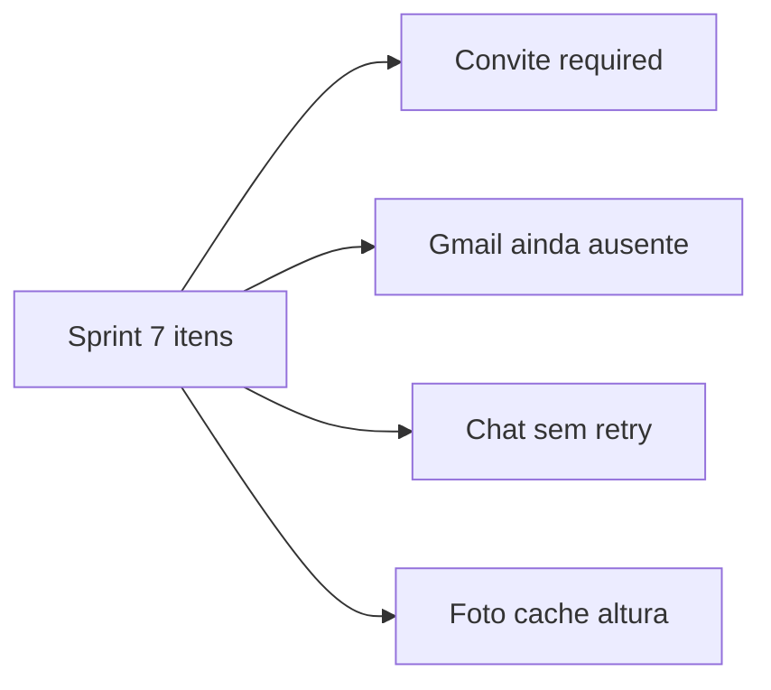

# Análise — sprint pré-reformulação do front

Fonte: `sprint-coachpass-pre-reformulacao-front.md` (WhatsApp, semana 43). Cruzado com o código em 22/10/2026. Este documento não implementa as correções.

## Veredito

Dos 7 itens, só o aceite de convite é um bug confirmado no código de hoje. O chat falha de forma intermitente porque não há retry e qualquer erro do Gemini vira a mesma frase. O e-mail de reset não chega porque o ambiente ainda usa Ethereal, não a conta Gmail. Os itens 4, 5, 6 e 7 são ajustes de produto, não furos de autorização.

## Item a item

### 1. Chat inconsistente — ainda acontece, causa já localizada

A frase da sprint está em [`AIChat.tsx`](../apps/fitsync-cms/src/web/components/AIChat.tsx) e em [`chat/route.ts`](../apps/fitsync-cms/src/app/(payload)/api/ai/chat/route.ts). Qualquer falha do Gemini (timeout, 429, 5xx, resposta vazia) vira HTTP 502 e essa mensagem. O `fetch` tem `AbortSignal.timeout(20_000)` em [`geminiProvider.ts`](../apps/fitsync-cms/src/services/ai/geminiProvider.ts) e não repete a chamada. O log só grava `Falha no chat IA`, sem o código do provedor. Quota de chat existe (30/dia); estourar a quota não é esse texto.

Aceite da sprint (estável + log) ainda não está cumprido. Correção: um retry em falha transitória, log interno com o código (sem vazar a chave) e mensagem distinta para timeout, quota e provedor.

### 2. Aluno não aceita o convite — bug confirmado

O dashboard chama `PATCH /api/professional-links/:id` só com `{ status }` em [`studentApi.ts`](../apps/fitsync-cms/src/web/lib/studentApi.ts) (`updateLinkStatus`). No update, o hook de [`ProfessionalLinks.ts`](../apps/fitsync-cms/src/collections/ProfessionalLinks.ts) apaga `student`, `professional` e `professionalRole`. Esses três campos são `required: true`. O Payload valida depois do hook e responde `This field is required.` É o mesmo tipo de falha que o PATCH de treino teve quando o hook removia `student`.

O fluxo certo já existe: aluno só sai de `pending` para `active` ou `revoked`. Não criar status `aceito`. No hook, recolocar os três campos a partir de `originalDoc` e manter a troca de status. Traduzir a mensagem genérica do Payload em [`cms.ts`](../apps/fitsync-cms/src/lib/cms.ts).

### 3. E-mail de reset não chega — a sprint troca Resend por Gmail

O template já aponta para `/redefinir-senha/:token` e o assunto é CoachPass ([`Users.ts`](../apps/fitsync-cms/src/collections/Users.ts)). Sem `SMTP_*`, o dev cai no Ethereal e a mensagem não entra no Gmail da pessoa. Produção nem sobe sem SMTP ([`env.ts`](../apps/fitsync-cms/src/lib/env.ts)).

A sprint pede a conta Gmail oficial, não Resend. O adapter atual (`nodemailer`) aceita SMTP do Gmail sem código novo:

- `SMTP_HOST=smtp.gmail.com`
- `SMTP_PORT=587`
- `SMTP_SECURE=false`
- `SMTP_USER` e `SMTP_FROM_EMAIL` = o Gmail do CoachPass
- `SMTP_PASS` = senha de app (não a senha da conta)

OAuth2 do Gmail só vale se a senha de app não for aceita. Quem cola as variáveis é o dono. Sem isso o critério “chegou na caixa” não fecha.

### 4. Reset “para qualquer e-mail” — o desenho certo já está no código

O Payload só dispara o e-mail se a conta existe. A API de forgot-password responde 200 tanto para e-mail cadastrado quanto para e-mail inexistente. Há limite de 5 pedidos por minuto por IP em [`middleware.ts`](../apps/fitsync-cms/src/middleware.ts). O token é o do Payload (uso único e com prazo).

O critério da sprint (“só cadastrados recebem” e “a resposta é igual”) já é o comportamento. Diferenciar a resposta reabriria enumeração de contas. O que ainda é fraco: o limite é um `Map` na memória (não vale entre instâncias na Vercel) e, sem SMTP real, ninguém recebe o link. Não tratar o item 4 como falha de “enviar o link para o e-mail de outra pessoa”.

### 5. Foto de perfil — ainda só avatar gerado

Não há `<input type="file">` na SPA. O avatar vem de ui-avatars. A collection `media` já restringe jpeg/png/webp/gif e tem dono, mas o disco local some em serverless. Subir foto de verdade na Vercel pede Blob/S3. Dá para fazer o upload no disco para a demo local; na URL publicada a foto se perde no próximo deploy. Avatar padrão (ui-avatars) já existe para quem não tem foto.

### 6. Cadastro perde o que foi digitado — verdade, e é só front

[`Register.tsx`](../apps/fitsync-cms/src/web/components/pages/Register.tsx) guarda o formulário só em estado React. Recarregar zera tudo. `sessionStorage` nos campos visíveis, sem a senha, e limpar a chave depois do `registerUser` cumpre o aceite. O onboarding do aluno tem o mesmo furo; a sprint cita a tela de cadastro.

### 7. Peso e altura — centímetros e quilos, sem metro nem vírgula

[`StudentOnboarding.tsx`](../apps/fitsync-cms/src/web/components/pages/StudentOnboarding.tsx) e [`StudentProfileEditor.tsx`](../apps/fitsync-cms/src/web/components/pages/StudentProfileEditor.tsx) usam `type="number"`. Placeholder de altura é `175`. No banco, `heightCm` é 50–250 e `weightKg` é 20–400 ([`StudentProfiles.ts`](../apps/fitsync-cms/src/collections/StudentProfiles.ts)). `1,75` não vira 175 cm: o input numérico rejeita a vírgula ou grava 1.75 e a validação recusa (mínimo 50). Falta normalizar `1,75` e `1.75` para 175 antes do `Number()`, com texto de ajuda. O mesmo vale para peso com vírgula (`75,5`).

## Ordem sugerida, se for implementar depois

1. Convite: restaurar `student`, `professional` e `professionalRole` no update e testar aceite/recusa.
2. Gmail: colar `SMTP_*` (senha de app) e testar o reset na caixa de entrada.
3. Chat: um retry e mensagem/log por tipo de falha.
4. Cadastro: `sessionStorage` sem senha; altura/peso aceitando metro e vírgula.
5. Foto: só se a demo precisar de upload de verdade; na Vercel isso pede storage externo.

Fora desta sprint: gateway, CSP enforce, JWT em cookie, TACO oficial, Sentry.
