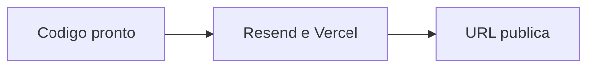

# Status — o que falta para o CoachPass ficar pronto

Atualizado em 21/10/2026 depois do plano “pronto para hospedar”.

## Veredito

O **ciclo de uso** (aluno + personal + nutri) está no código, com check-in/RPE, dieta IA, foods e financeiro manual. Para um usuário de verdade falta **você** colar SMTP Resend e publicar na Vercel. Cobrança de planos fica de fora. A chave Gemini no `.env` local é aceitável neste trabalho de faculdade.

## Já está pronto

- Auth, onboarding, convite (anti-enumeração + e-mail pelo adapter), aceite/revoga
- Treino e plano persistidos, com PATCH / edição
- Avaliação, agenda, restrição, anamnese, perfil, Settings sem Supabase
- Reset em `/redefinir-senha/:token`, consentimento, `GET /api/me/export`, delete de conta
- IA: treino, chat, dieta (`POST /api/ai/generate-meal-plan`), quota 2/mês cada
- Check-in de treino (`workout-logs`) com RPE 1–10; Evolução e ficha do personal (`StudentDetails`) listam os logs
- Alimentos TACO/TBCA de referência (`foods`, ~30 itens) no plano do nutri
- Financeiro manual (`transactions`); aluno vê Pagamentos; gateway desligado
- Homologação cobre foods, workout-logs, transactions e quota de dieta IA
- Deploy: [`vercel.json`](../apps/fitsync-cms/vercel.json), `npm run migrate`, CORS com `VERCEL_URL`, `allowedDevOrigins` ngrok
- Túnel: `https://smokeless-severity-exciting.ngrok-free.dev` (health 200)

Collections em [`apps/fitsync-cms/src/payload.config.ts`](../apps/fitsync-cms/src/payload.config.ts): users, media, student-profiles, professional-links, workouts, meal-plans, ai-generations, assessments, sessions, restrictions, anamneses, workout-logs, foods, transactions.

## Bloqueia “no ar” — dono, não código

1. **Conta Resend** — cole `SMTP_*` no `.env` e na Vercel (build + runtime). Sem isso produção não sobe. `onboarding@resend.dev` só entrega na caixa da conta; domínio verificado se a banca precisar receber e-mail.
2. **Publicar na Vercel** — root `apps/fitsync-cms`, `PAYLOAD_DATABASE_PUSH=false`, `npm run migrate` **antes** do primeiro deploy, `PAYLOAD_PUBLIC_SERVER_URL` / `FITSYNC_FRONTEND_URL` = URL final. Passo a passo em [`docs/DEPLOY.md`](DEPLOY.md).
3. **Backup automático Neon** — snapshot manual `coachpass-pre-cleanup` existe; schedule não. Para faculdade o snapshot manual basta.
4. **`MASTER_PASSWORD` no `.env`** — admin master não foi retestado no e2e.

## Acabamento que fica para depois

- `foods` é recorte de referência, não a tabela TACO oficial.
- CSP ainda Report-Only em [`next.config.mjs`](../apps/fitsync-cms/next.config.mjs).
- `npm audit` highs transitivos (CI não bloqueia).
- Media em disco local — só importa se houver upload de avatar (hoje é ui-avatars).
- CI: tsc + int + `migrate:status` (se houver secrets) + e2e Playwright (se houver secrets) + audit.
- ESLint roda no `next build` (`ignoreDuringBuilds: false`).
- JWT no `localStorage` (risco conhecido, aceito no MVP).
- Rate-limit do login é `Map` in-memory — no serverless o 429 não é global.

## De propósito fora

- Gateway / planos pagos ([`Plans.tsx`](../apps/fitsync-cms/src/web/components/pages/Plans.tsx) é vitrine; funções liberadas)
- Periodização, metas, questionários, cursos, canvas, materno-infantil
- Relatório PDF (rota redireciona para a ficha)
- Sentry

## Ordem para ficar no ar

1. Você: conta Resend + env na Vercel (Production e Preview).
2. Você: `npm run migrate` no Neon, depois deploy. Conferir `GET /api/health`.
3. Opcional depois: CSP enforce, e2e no CI, Blob se houver upload.
