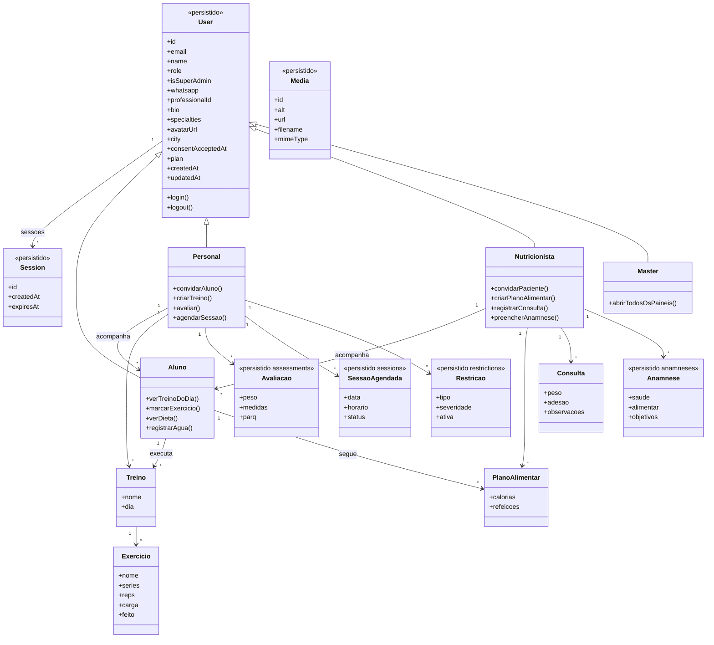

# CoachPass — diagrama de classes

O que está marcado como persistido já existe no Postgres. Fora do MVP: financeiro, alimentos TACO, check-in de treino e dieta por IA.

Papéis em `User.role`: `student`, `personal`, `nutritionist`, `master`.

Fora do recorte: questionários, metas, periodização, materno-infantil, cursos e canvas.
