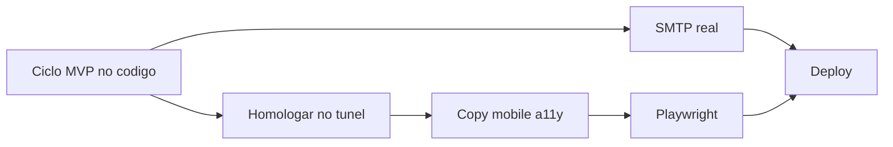

# O que falta para o CoachPass ficar redondo

A parte de **funcionar** (Mendes + Petter) já está no código: login, vínculo, treino/plano persistidos, avaliação/agenda/restrição/anamnese, reset, consentimento, export/delete, Gemini.

O que falta é deixar isso **confiável, apresentável e publicável**.

## Já está pronto — não reabrir

- Servidor: access, collections, quota, health, invite anti-enumeração
- SPA: reset em [`ResetPassword.tsx`](apps/fitsync-cms/src/web/components/pages/ResetPassword.tsx), aceite de convite, [`professionalApi.ts`](apps/fitsync-cms/src/web/lib/professionalApi.ts), persistência de treino/plano, detalhes reais, Settings sem Supabase
- Fora do MVP de propósito: dieta IA, financeiro, TACO, check-in

## P0 — sem isso o produto não “fecha” para um usuário de verdade

1. **SMTP real** (bloqueio do dono, não de código)
   - Sem provedor, recuperação de senha e convite por e-mail não chegam. A tela de reset já existe; o link só sai no log Ethereal.
   - Precisa: domínio + Resend/Postmark/SES e `SMTP_*` no `.env`. Em produção o app **não sobe** sem isso ([`docs/DEPLOY.md`](docs/DEPLOY.md)).

2. **Homologar o ciclo no túnel** ([`docs/CHECKLIST_HOMOLOGACAO.md`](docs/CHECKLIST_HOMOLOGACAO.md) ainda todo em aberto)
   - personal convida `aluno@coachpass.app` → aluno aceita → publica treino → aluno vê
   - nutri o mesmo com plano
   - forgot → token → `/redefinir-senha/:token`
   - admin só master; 403 cruzado; quota IA 402
   - Contas demo: `DEMO_PASSWORD` ainda não está no `.env` local — o seed não roda sem isso.

3. **Rotacionar a chave Gemini**
   - Foi colada no chat. Depois de confirmar o bot, revogar e gerar outra.

## P1 — para ficar redondo de uso (1–2 sessões)

4. **Copy e mentiras de protótipo (T4.1)**
   - [`Register.tsx`](apps/fitsync-cms/src/web/components/pages/Register.tsx): “Identificação formal”, “Correio Eletrônico”, “Efetuar Autenticação”
   - [`AIChat.tsx`](apps/fitsync-cms/src/web/components/AIChat.tsx): “Online agora” é falso
   - Páginas órfãs ainda no repo (sem rota): `PersonalCursos`, `*Questionarios`, `*Canvas`, `*Metas`, `*Financeiro`, `PersonalPeriodizacao` — apagar ou deixar mortas sem menu

5. **Editar o que já criou**
   - Treino e plano hoje só **criam**. Falta abrir um existente e PATCH.
   - Avaliação/anamnese já atualizam; treino/plano não.

6. **Mobile e acessibilidade (T4.3–T4.4)**
   - Agenda e tabelas em 375px; `htmlFor`/`aria-label` nos formulários novos; contraste AA.

7. **E-mail de convite**
   - O aluno só vê o pendente se entrar no app. Sem SMTP + e-mail “você foi convidado”, o vínculo depende de combinarem no WhatsApp.

## P2 — para dormir tranquilo em produção

8. **Playwright de verdade (T5.2)** — [`tests/e2e/frontend.e2e.spec.ts`](apps/fitsync-cms/tests/e2e/frontend.e2e.spec.ts) ainda espera “Payload Blank Template”
9. **Hospedagem + backup automático** — Vercel/Fly + Neon snapshot agendado ([`docs/DEPLOY.md`](docs/DEPLOY.md), [`docs/RUNBOOK.md`](docs/RUNBOOK.md))
10. **`npm audit` leftover highs** e CSP de Report-Only para enforce, se o admin não quebrar

## Fora até o produto decidir

Dieta por IA, financeiro, TACO, check-in de treino, planos pagos.

## Próximo passo recomendado

Não abrir outra fatia de telas. **Configurar SMTP** (você) e **rodar o checklist no túnel** (nós). Se o ciclo passar, o restante é polish + Playwright.
